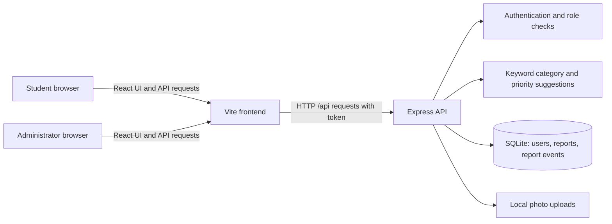

# CampusFix Project Report

## Project title

**CampusFix — Snap. Report. Resolve.**  
An online campus infrastructure complaint reporting and tracking system

## Abstract

CampusFix is a web application for reporting and tracking infrastructure issues on a campus. Students can describe an issue, add its location and a photo, receive suggested category and priority values, submit a complaint, and track its status and history. Administrators can review campus-wide reports, see the associated student information, filter and search complaints, update statuses, delete reports, and view summary analytics.

The application has two roles: student and administrator. Authorization is enforced by the API so students can access only their own complaint records while administrators can access all records. The current implementation is a functional prototype using React, Express, and SQLite. Its categorization is keyword-based; it does not yet use a machine-learning vision model, dispatch work to a maintenance system, or send notifications. Those items are documented as future work rather than completed features.

## 1. Introduction

Campus buildings and facilities need regular maintenance. Students are often the first to notice a leaking tap, damaged furniture, a lighting fault, or a safety concern, but they may not know which department or person to contact. Reports sent through informal channels can be incomplete, difficult to follow up, or lost among unrelated messages.

CampusFix provides one structured place to submit these issues. It records the description, location, category, priority, optional photograph, current status, and status history. Students can follow their own submissions, while administrators receive a campus-wide view for triage and response.

### 1.1 Problem statement

Students lack a consistent, easy-to-find process for reporting campus infrastructure problems. Campus staff need reports with enough context to understand and prioritize an issue, and both parties need a clear way to follow its progress.

### 1.2 Proposed solution

CampusFix provides a role-based reporting workflow:

1. A student signs in and submits a description, location, and optional photo.
2. The application suggests a category and priority from the description.
3. The student reviews the suggestions and submits the report.
4. The student tracks the status and status-history timeline of that report.
5. An administrator reviews the campus-wide queue, updates status, and uses summary views to monitor reports.

In this prototype, “sends it to maintenance” means the report becomes visible to administrators in the application. It is not yet integrated with an external maintenance team, ticketing service, email, or messaging system.

### 1.3 Aim

To build a clear, attractive, and usable web prototype that makes campus issue reporting easier for students and gives administrators a secure place to manage and monitor reports.

### 1.4 Objectives

- Provide separate student and administrator experiences.
- Let students register, sign in, submit complaints, and review only their own reports.
- Accept an optional issue photograph and retain it with the report.
- Suggest issue category and priority to make reports more structured.
- Preserve report status changes as a timeline.
- Give administrators access to all reports and relevant student information.
- Support search, filtering, status updates, deletion, and basic analytics for administrators.
- Apply server-side role and ownership checks to private data and operations.

## 2. Scope

### Included in the current prototype

- Student registration and sign-in, plus administrator sign-in.
- Two account roles: `student` and `admin`.
- Student complaint creation with description, location, category, priority, and optional photo.
- Rule-based category and priority suggestions based on text keywords.
- Student-only report listing and report detail access.
- Administrator campus-wide report listing and student details associated with reports.
- Administrator search/filter, status changes, deletion, and summary analytics.
- A per-report status history with timestamps, notes, and actor information.
- An illustrative campus schematic with report markers.
- Optional frontend-only demo records for demonstrating the administrator dashboard.
- Responsive interface styling and reduced-motion support.

### Not included yet

- Real AI image recognition or a trained classification model.
- Automatic assignment to named maintenance staff or departments.
- Email, SMS, push, or in-app notifications.
- A real geospatial campus map or verified GPS coordinates.
- A production deployment, campus identity-provider integration, or multi-campus support.
- Formal user-interview or usability-study results.

## 3. Users and permissions

| Role | Current capabilities | Data boundary |
|---|---|---|
| Student | Register/sign in, create reports, view report details and status history, track progress | Can list and open only reports belonging to their account; cannot browse campus-wide reports or student records |
| Administrator | Sign in, list and inspect all reports, view associated student information, search/filter, update status, delete reports, view summary analytics | Can access campus-wide complaint and student information |

The interface presents separate role-specific experiences, but the API is the security boundary: it checks the authenticated user and role for protected operations rather than relying on hidden frontend screens.

## 4. Methodology

The project is organized around Design Thinking and a Product Lifecycle Management (PLM) view. The application implementation is complete as a prototype; formal field research, pilot deployment, and ongoing operations remain future project activities.

### 4.1 Design Thinking

| Stage | Application to CampusFix | Project status |
|---|---|---|
| Empathize | Understand how students currently report faults and what information maintenance staff need. Interview students and campus staff. | The need is defined for the project. Formal interviews have not yet been documented; conduct them as validation work. |
| Define | Frame the central issue as reporting friction, incomplete information, unclear ownership, and lack of progress visibility. | Reflected in the problem statement and two-role workflow. |
| Ideate | Explore a structured form, photo attachment, suggested category/priority, private student tracking, and an administrator queue. | The selected feature set is represented in the prototype. |
| Prototype | Build the React interface, Express API, SQLite data store, authentication, report workflow, and dashboards. | Implemented as a working local prototype. |
| Test | Ask representative students and administrators to perform reporting and triage tasks; observe errors and improve the interface. | Basic build, lint, and API smoke checks have been performed. Formal usability testing with participants is still to be conducted and recorded. |

### 4.2 PLM lifecycle

| Lifecycle phase | CampusFix activity | Status |
|---|---|---|
| Idea | Make campus maintenance reporting easier and trackable. | Completed as the project concept. |
| Requirements | Define roles, privacy boundaries, report fields, and admin workflow. | Implemented as prototype requirements. |
| Design and development | Create interface, API, database, access control, and analytics. | Implemented locally. |
| Pilot | Trial the workflow with a limited group of students and campus administrators. | Planned. |
| Campus deployment | Host securely and connect the process to the campus maintenance operation. | Planned. |
| Maintenance | Monitor, fix defects, update dependencies, and support users. | Required after deployment. |
| Upgrades | Add validated AI assistance, notifications, integrations, and operational improvements. | Future scope. |

## 5. Requirements and implementation

### 5.1 Functional requirements

| Requirement | Implementation |
|---|---|
| Student account registration and login | API registration creates student accounts; login returns a signed token for authenticated requests. |
| Role-specific experience | Student and administrator screens are separated in the frontend; role checks are also enforced by the API. |
| Submit a complaint | Student submits description, location, category, priority, and optional photo. |
| Suggest category and priority | Authenticated analysis endpoint applies keyword rules to report text and returns suggestions that can be reviewed. |
| Restrict student data | Student list and detail endpoints are limited to the authenticated student's reports. |
| Show administrator all reports | Administrator endpoint returns campus-wide reports with associated student information. |
| Track progress | Report detail includes status history; administrators can update status and add a history event. |
| Delete a report | Administrator-only deletion removes the report and its history; an uploaded local photo is also cleaned up. |
| View analytics | Administrator summary endpoint supplies report counts and breakdowns used in dashboard visualizations. |
| Demonstration data | Administrator can preview clearly labelled fictional frontend-only records; these are not saved to SQLite. |

### 5.2 Non-functional requirements addressed

- **Privacy:** student report queries are ownership-scoped; administrator-only operations require an administrator role.
- **Usability:** separate role-specific views, report status indicators, search/filter controls, and a responsive layout.
- **Maintainability:** frontend, API routes, and database responsibilities are separated into project modules.
- **Security basics:** password hashing, signed authentication tokens, security headers, login rate limiting, request validation, and upload limits.
- **Traceability:** status changes are stored as report events with actor and timestamp.

These are prototype-level controls, not a substitute for a production security review or operational policy.

## 6. System design and architecture

### 6.1 Architecture overview



During local development, Vite serves the frontend and proxies `/api` requests to the Express server. The API handles authentication, authorization, validation, file upload, persistence, and report operations. SQLite stores accounts, complaints, and history; uploaded images are stored under the project uploads directory.

### 6.2 Main application flow

1. The user signs in; the frontend stores the returned authentication token for subsequent API requests.
2. The frontend includes the token when it calls protected API routes.
3. Express verifies the token and checks the role and, for student report access, ownership.
4. The report API reads or writes SQLite records. Uploaded photos are handled by the server upload middleware and stored locally.
5. The frontend renders only the data returned to that role. Administrators can change report status, which adds a history event.

### 6.3 Data model

| Table | Purpose | Main information |
|---|---|---|
| `users` | Student and administrator accounts | Name, email, password hash, role, and student identifier where supplied |
| `reports` | Complaint records | Owner, description, location, category, priority, status, image path, and creation/update timestamps |
| `report_events` | Report history | Report reference, status, note, actor, and event timestamp; events are removed when their report is deleted |

An index supports report lookup by user and date. The database file used for local development is `server/campusfix.sqlite`; the upload folder is `uploads/`.

### 6.4 API overview

All endpoints are under `/api`.

| Method and route | Access | Purpose |
|---|---|---|
| `POST /auth/register` | Public; creates student role only | Register a student account |
| `POST /auth/login` | Public, rate-limited | Authenticate and issue a token |
| `GET /auth/me` | Authenticated | Return the current account |
| `GET /reports` | Student or admin | Student receives own reports; admin receives all reports with student details |
| `POST /reports/analyze` | Authenticated | Return rule-based category and priority suggestions |
| `POST /reports` | Student | Create a report with an optional image upload |
| `GET /reports/:id` | Owner or admin | Return report details and status history |
| `GET /reports/:id/photo` | Owner or admin | Serve the protected report photo |
| `PATCH /reports/:id/status` | Admin | Update status and record the change in history |
| `DELETE /reports/:id` | Admin | Delete a report and associated history/photo |
| `GET /admin/summary` | Admin | Return data used by administrator analytics |

## 7. Technical stack

| Layer | Technology | Use in the project |
|---|---|---|
| Frontend framework | React 19 | Component-based student and administrator experiences |
| Frontend tooling | Vite 8 | Development server, API proxy, and production frontend build |
| Styling | CSS | Responsive dashboard layouts, forms, cards, status states, animations, and reduced-motion handling |
| Backend runtime | Node.js | Runs the API server and development tooling |
| API framework | Express 5 | Authentication and report endpoints, middleware, and request handling |
| Database | SQLite via `better-sqlite3` | Persistent local account, report, and history storage |
| Authentication | `jsonwebtoken` | Signed bearer tokens for API requests |
| Password hashing | `bcryptjs` | Store password hashes rather than plaintext passwords |
| Image upload | `multer` | Accept optional report image uploads with server-side limits |
| Security middleware | `helmet`, `express-rate-limit` | HTTP security headers and login rate limiting |
| Configuration | `dotenv` | Load local secrets and server configuration from `.env` |
| Code quality | ESLint | Static linting of project JavaScript/JSX |

## 8. Frontend features and screens

- Role selection and separate student/admin sign-in presentation.
- Student registration; public registration creates student accounts only.
- Student dashboard showing their own complaints, status, and progress.
- New complaint form with location, description, optional image, and category/priority suggestions.
- Complaint detail view with status-history timeline.
- Administrator dashboard with all reports and associated student information.
- Administrator search and filters for report triage.
- Administrator status controls and deletion with a confirmation step.
- Analytics visualizations for status, category, and monthly report trends.
- Clickable illustrative campus schematic with report markers.
- Clearly identified demo-data preview for presentation purposes.
- Responsive styling, lightweight transitions, and reduced-motion support.

## 9. Security and privacy

- Passwords are stored as bcrypt hashes.
- Protected API routes require a signed token.
- Student registration cannot choose the administrator role.
- Student report list, detail, and photo access are restricted to the report owner.
- Administrator-only routes enforce the administrator role on the server.
- Login attempts are rate-limited; Helmet provides common security headers.
- Report image uploads have a configured size limit (10 MB) and are served through an ownership-checked endpoint.
- Local secrets and administrator bootstrap credentials belong in `.env`, which should remain private and must not be committed or included in a report.

Before production use, review token lifetime and storage, password and account policies, upload content validation and malware handling, HTTPS, backups, audit requirements, deployment secrets, and data-retention policy.

## 10. Verification performed

The project has been checked with the available development scripts and API smoke flows:

- `npm run lint` completed successfully.
- `npm run build` completed successfully.
- Node.js syntax checking for the API entry point completed successfully.
- API smoke checks verified that students can create and access their own reports, cannot access another student's reports, and cannot update or delete reports as an administrator.
- API smoke checks verified that administrators can see report-associated student information, update a report status, and generate a history event.
- Delete-flow smoke check verified student deletion is rejected, administrator deletion succeeds, and the deleted report is no longer found.

These checks validate core prototype behavior. They are not a formal test suite, penetration test, load test, or usability study. Avoid describing participant interviews or usability testing as completed unless the team conducts and records them.

## 11. Known limitations

- Category and priority suggestions use fixed keyword rules; they are not generated by an AI model and do not inspect the uploaded photo.
- Suggested category and priority require user review and can be inaccurate for ambiguous descriptions.
- The campus map is an illustrative schematic. Marker placement is based on location text rather than surveyed coordinates.
- Reports appear in the administrator queue, but the app does not notify or automatically assign them to a maintenance worker.
- No email, SMS, push, or external ticketing integration is configured.
- SQLite and local photo storage suit a local prototype; they need an operational backup and deployment plan before campus-wide use.
- The demo-data preview is fictional and frontend-only; it is not real campus data.
- Formal interviews, accessibility evaluation, and participant-based usability testing remain to be conducted.

## 12. Future scope

### Near term

- Conduct and document student and facilities-staff interviews.
- Run moderated usability tests on reporting, finding a complaint, and updating its status; fix observed issues.
- Add automated API and frontend tests for role boundaries, validation, status history, uploads, and deletion.
- Improve form feedback, error states, keyboard navigation, and accessibility checks.
- Add administrator report export and clearer operational filters.

### Product and integration improvements

- Add maintenance departments, staff accounts, assignment, and workload queues.
- Send email or in-app updates when a report is received or its status changes.
- Integrate with an existing campus work-order or facilities-management system.
- Add comments and a controlled request-for-more-information workflow.
- Add duplicate-report detection and configurable service-level targets.

### AI and location improvements

- Evaluate a real text-classification service against a labelled set of campus reports; keep the student/admin able to review suggestions.
- If appropriate and privacy-reviewed, evaluate photo classification for issue type and urgency; do not treat image predictions as confirmed facts.
- Replace heuristic markers with a campus map and managed building/room locations, optionally using geolocation with clear consent.

### Deployment and operations

- Deploy behind HTTPS with managed secrets and a production database/storage service.
- Add backups, retention controls, monitoring, audit logs, and incident procedures.
- Integrate campus single sign-on and define account deactivation and administrator governance.
- Pilot with one department, gather feedback, measure resolution time and report quality, then plan a wider rollout.

## 13. Local setup and operation

1. Install a supported Node.js release (the project setup specifies Node 20.19+ or 22.12+).
2. Install dependencies with `npm install`.
3. Copy `.env.example` to `.env` and set a strong `JWT_SECRET` and local administrator credentials. Keep `.env` private.
4. Start the API with `npm run api`.
5. In a second terminal, start the frontend with `npm run dev`.
6. Open the local URL printed by Vite. The development frontend proxies `/api` requests to the local API server.

Useful scripts:

```text
npm run dev      Start the Vite development server
npm run api      Start the Express API
npm run build    Build the frontend for production
npm run preview  Preview the production frontend build
npm run lint     Run ESLint
```

## 14. Conclusion

CampusFix turns campus infrastructure reporting into a structured, trackable workflow. Its current prototype demonstrates the key student and administrator experiences, server-enforced role boundaries, report history, image uploads, status management, deletion, and dashboard summaries. It is suitable for demonstrating the concept and gathering early feedback. A campus pilot should follow user research, usability validation, production security and hosting work, and integration with the real facilities process. AI-based image recognition, automatic maintenance dispatch, notifications, and real map data remain future enhancements.

## Appendix: suggested project demonstration

1. Show the student sign-in or registration and explain that registration creates a student account.
2. Create a sample report with an issue description, location, and optional photograph.
3. Show the suggested category/priority, then submit the report.
4. Open the student report detail and point out the status and timeline.
5. Sign in as an administrator and show the campus-wide queue, student details, filters, and analytics.
6. Update the report status and return to the student view to show the changed timeline.
7. If no demonstration records exist, use the explicitly labelled demo-data preview and explain that it is fictional and not saved in the database.
